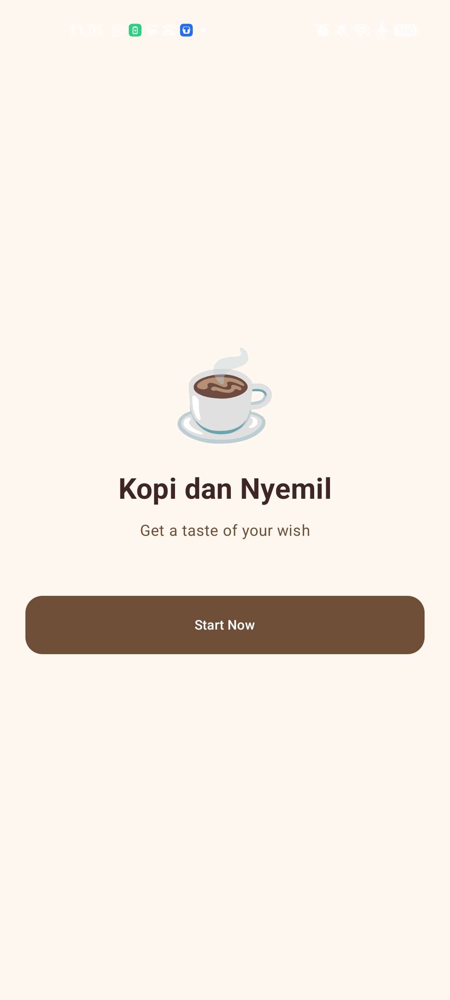
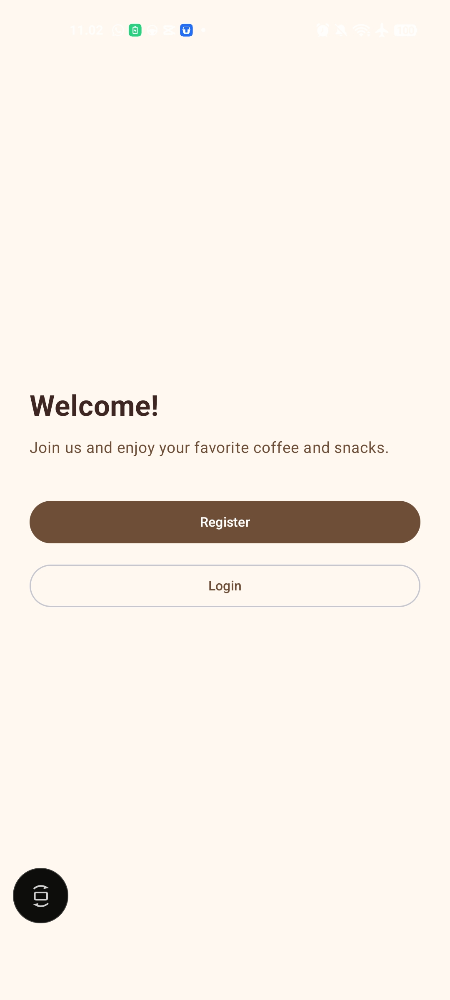
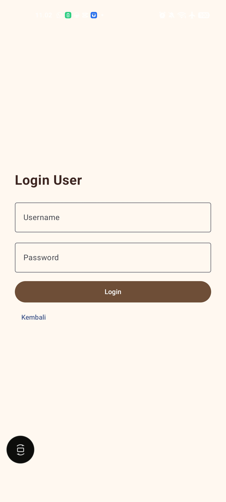
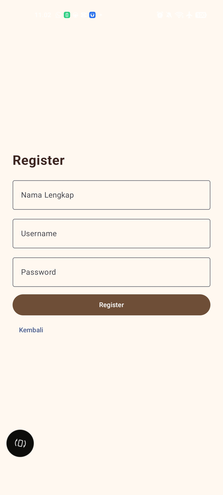
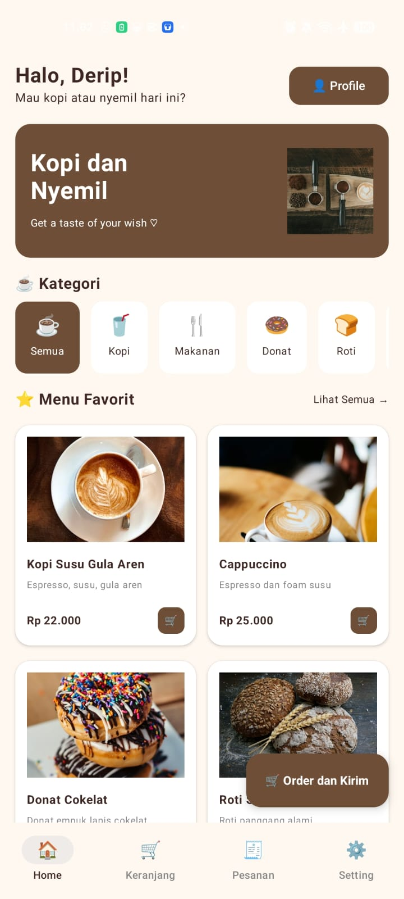
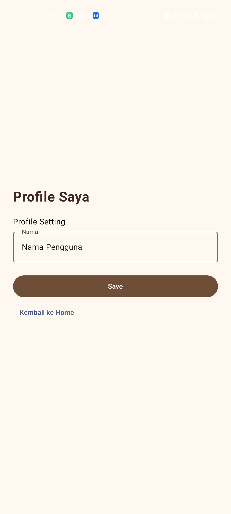
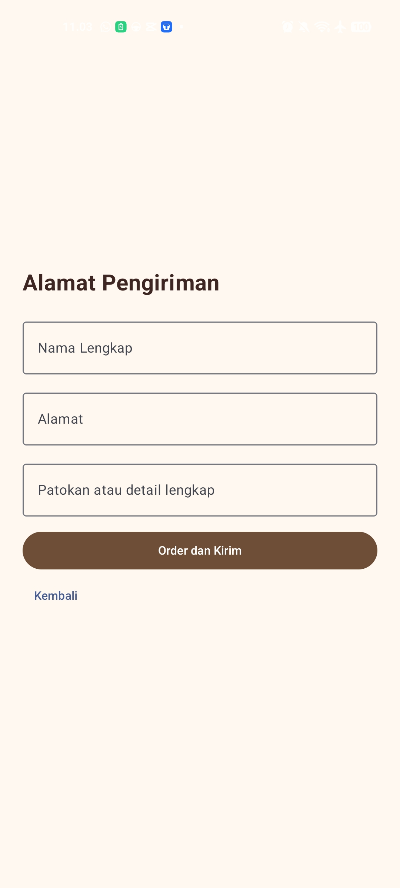
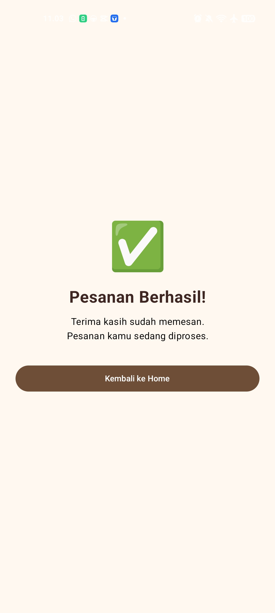

# ☕ Kopi dan Nyemil

Aplikasi mobile pemesanan kopi dan camilan berbasis Android (Kotlin + Jetpack Compose) dengan desain *clean* bernuansa cokelat dan krem. Dibuat untuk memenuhi tugas Ujian Tengah Semester (UTS) mata kuliah Pemrograman Mobile.

**Tagline:** *Get a taste of your wish*

## 📱 Deskripsi

Pengguna dapat mendaftar atau masuk ke dalam aplikasi, menjelajahi menu makanan dan minuman, mengisi detail alamat pengiriman, dan menyelesaikan pesanan. Aplikasi ini dibangun tanpa menggunakan database eksternal; seluruh data yang ditampilkan bersifat statis (dummy data) dan berjalan di dalam memori perangkat.

## ✨ Fitur

- **Splash / Welcome:** Tampilan awal aplikasi dengan logo cangkir kopi, tagline "Get a taste of your wish", dan tombol "Start Now".
- **Sign Up (Welcome!):** Halaman awal yang memberikan pilihan kepada pengguna untuk "Register" atau "Login".
- **Login User:** Halaman masuk akun menggunakan *Username* dan *Password*.
- **Register:** Halaman pendaftaran akun baru yang meminta *Nama Lengkap*, *Username*, dan *Password*.
- **Home:** Halaman utama yang interaktif, berisi:
    - Sapaan kepada pengguna ("Halo, Derip!").
    - Kategori filter menu (Semua, Kopi, Makanan, Donat, Roti).
    - Daftar "Menu Favorit" dengan foto, deskripsi, harga, dan tombol keranjang (misalnya: Kopi Susu Gula Aren, Cappuccino).
    - Bottom Navigation Bar (Home, Keranjang, Pesanan, Setting).
- **Profile:** Halaman untuk melihat dan mengatur "Nama Pengguna".
- **Alamat Pengiriman:** Formulir pemesanan yang mencakup pengisian "Nama Lengkap", "Alamat", dan "Patokan atau detail lengkap".
- **Konfirmasi Pesanan:** Halaman akhir dengan ikon centang hijau yang menampilkan pesan "Pesanan Berhasil!" dan instruksi bahwa pesanan sedang diproses.

## 🛠️ Teknologi

- **Bahasa Pemrograman:** Kotlin
- **UI Toolkit:** Jetpack Compose
- **IDE:** Android Studio
- **Arsitektur Data:** Data Statis (Dummy Data)

## 🚀 Cara Menjalankan

1. Pastikan **Android Studio** versi terbaru sudah terinstal di komputer Anda.
2. *Clone* repository ini atau unduh (download) folder proyeknya.
3. Buka Android Studio, lalu pilih menu **File > Open** dan buka folder proyek `KopiDanNyemil`.
4. Tunggu beberapa saat hingga proses *Gradle Sync* selesai.
5. Jalankan aplikasi menggunakan Emulator bawaan Android Studio atau sambungkan HP Android Anda menggunakan kabel USB.
6. Klik tombol **Run** (ikon segitiga hijau) di bagian atas untuk menjalankan aplikasi.

## 🔄 Alur Aplikasi

Splash ➔ Sign Up (Welcome) ➔ Login / Register ➔ Home ➔ Alamat Pengiriman ➔ Konfirmasi Pesanan

## 📸 Screenshot

| Splash Screen | Sign Up / Welcome | Login | Register |
|:-------------:| :---: | :---: | :---: |
|    |  |  |  |

| Home | Profile | Alamat Pengiriman | Konfirmasi Pesanan |
| :---: | :---: | :---: | :---: |
|  |  |  |  |


## 📁 Struktur Project
Berdasarkan package `com.derip.kopidannyemil`:
```text
app/src/main/java/com/derip/kopidannyemil/
├── MainActivity.kt        # Titik masuk aplikasi dan routing utama
└── ...                    # Komponen UI dan data lainnya
```
## 👤 Author

Nama : Derip Abdul Rohman

NIM : 1247050101 

Mata Kuliah : Pengembangan Aplikasi Mobile